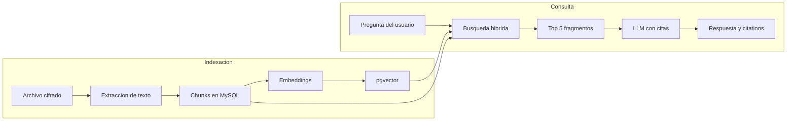
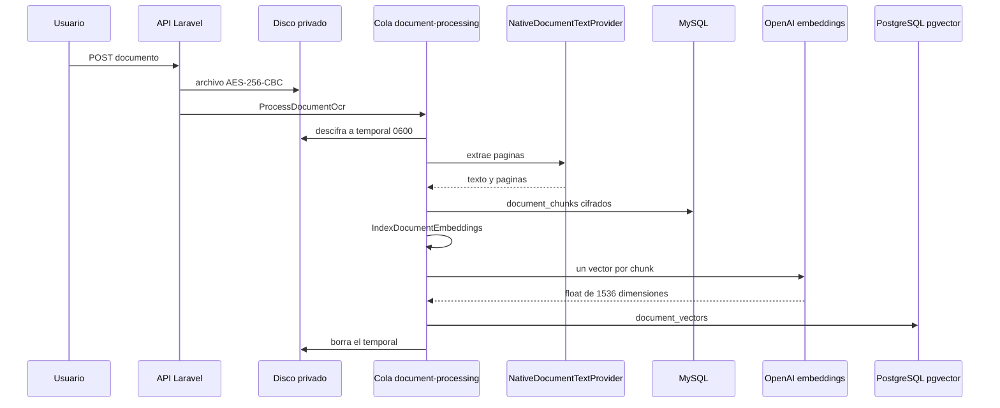
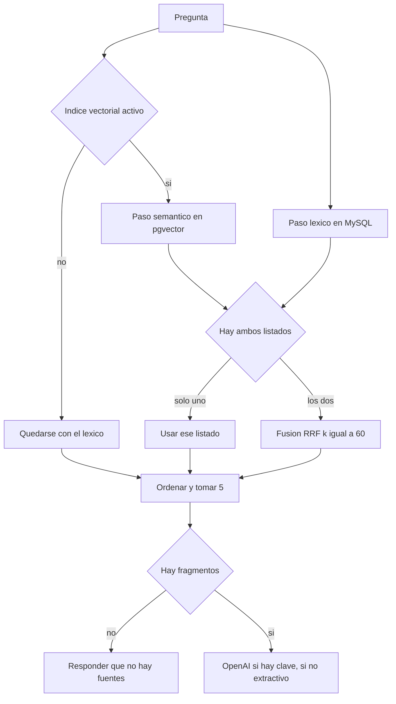

# Esquema RAG de LegalCloud AI

Guía para exponer el sistema de recuperación aumentada (RAG) del proyecto. El esquema describe el código actual de `Legalcc2`: qué se indexa, cómo se recupera y cómo el modelo responde solo con fragmentos autorizados.

## Qué decir al abrir (30 segundos)

LegalCloud es un archivo jurídico multi-organización. El asistente no responde de memoria: primero recupera fragmentos de los documentos de esa organización y después pide al modelo que redacte la respuesta citando esas fuentes. Si no hay evidencia, no llama al modelo.

RAG aquí significa tres pasos:

1. **Indexar** el documento en fragmentos con su vector.
2. **Recuperar** los fragmentos más útiles para la pregunta, por palabras y por significado.
3. **Generar** una respuesta en español que cite esos fragmentos como `[S1]`, `[S2]`, etc.

## Mapa de una sola vista



MySQL es la fuente de verdad: usuarios, expedientes, permisos, versiones, texto y citas. PostgreSQL con `pgvector` solo guarda el índice semántico. Antes de devolver un resultado, el sistema vuelve a comprobar en MySQL que el fragmento pertenece a la organización y a la versión vigente.

## Fase 1. Indexación

Ocurre al cargar un documento. La petición HTTP no espera el OCR ni los embeddings: deja un job en la cola `document-processing`.



Pasos concretos:

| Paso | Clase | Qué hace |
| --- | --- | --- |
| 1 | `DocumentController` | Guarda el original cifrado en `storage/app/private` y crea una versión inmutable con checksum SHA-256. |
| 2 | `ProcessDocumentOcr` | Descifra a un archivo temporal con permisos `0600`, extrae texto y borra el temporal al terminar. |
| 3 | `NativeDocumentTextProvider` | Lee PDF con capa de texto, DOCX y texto plano. Imágenes y Word `.doc` quedan sin proveedor. |
| 4 | `DocumentChunker` | Parte cada página en ventanas de 240 palabras con solapamiento de 40. |
| 5 | `IndexDocumentEmbeddings` | Borra los vectores viejos de esa versión y vuelve a indexar los chunks. |
| 6 | `OpenAiEmbeddingProvider` | Llama a `POST /embeddings` con `text-embedding-3-small`. |
| 7 | `VectorIndexService` | Inserta en `document_vectors`. El texto del chunk va cifrado; el vector queda consultable. |

El índice de cada chunk es `página * 10000 + índice dentro de la página`. Así se puede reindexar la misma versión sin mezclar páginas. La clave única en PostgreSQL es `(document_version_id, chunk_index)`.

### Por qué se parte el documento

Un contrato o un expediente no cabe en el contexto del modelo, y meterlo entero mezclaría páginas irrelevantes. El chunk conserva la página de origen para poder citarla. El solapamiento de 40 palabras evita que una frase cortada en el borde de la ventana desaparezca de la búsqueda.

### Tabla vectorial

`php artisan legalcloud:vector-migrate` crea la extensión `vector`, la tabla `document_vectors` y un índice HNSW con distancia coseno (`vector_cosine_ops`). Cada fila guarda:

- organización, documento, versión, expediente y categoría;
- índice de chunk y página;
- contenido cifrado y versión de cifrado;
- embedding `vector(1536)` y nombre del modelo;
- fecha del documento, para filtrar por rango.

El modelo por defecto es `text-embedding-3-small` y la dimensión por defecto es 1536 (`VECTOR_EMBEDDING_DIMENSIONS`).

## Fase 2. Recuperación

La pregunta entra por `POST /api/v1/assistant/conversations/{conversationId}/messages`. `AssistantController` persiste la pregunta, llama a `RagAnswerService` y, si hay respuesta, guarda el texto y una fila de `citations` por cada fuente. El catálogo del resto de la API está en [backend.md](backend.md).



Hay dos recuperadores y no se mezclan sus puntuaciones crudas.

**Léxico.** `RagAnswerService::lexicalPassages` parte la pregunta en términos de al menos 3 caracteres, toma hasta 10 y busca coincidencias dentro de los chunks de la versión vigente. El score es `coincidencias / cantidad de términos`. Solo entran documentos de la organización, y se puede acotar por expediente o por lista de documentos.

**Semántico.** `VectorIndexService::search` embebe la pregunta con el mismo modelo, filtra por `organization_id` y por expediente, categoría, documentos o fechas, y ordena por distancia coseno. El score expuesto es `1 - distancia`. Para el asistente se piden hasta 20 chunks, sin quedarse solo con el mejor chunk de cada documento.

**Fusión.** Si los dos listados traen resultados, `ReciprocalRankFusion` los combina. La constante `k` es 60. Un resultado en la posición `r` aporta `1 / (60 + r + 1)`. Si aparece en las dos listas, suma las dos aportaciones. Después se normaliza para que el mejor quede en 1.

`finalize` ordena por score, se queda con **cinco** fragmentos, numera las citas desde 1 y recorta el extracto de la cita a 800 caracteres. Al modelo se le envían hasta 2400 caracteres de cada fragmento.

### Búsqueda de documentos, aparte del asistente

`POST /search` tiene tres modos:

| Modo | Comportamiento |
| --- | --- |
| `keyword` | Solo `DocumentTextSearch` sobre título, descripción y chunks en MySQL. |
| `semantic` | Solo pgvector. Falla con 503 si el índice o el proveedor de embeddings no están activos. |
| `hybrid` | Si el índice está activo, `HybridSearch` fusiona semántico y léxico con el mismo RRF. Si no, cae a MySQL. |

En la búsqueda de documentos, la fusión es por documento. En el asistente, la fusión es por fragmento: documento, página y extracto.

## Fase 3. Generación

Si OpenAI no está habilitado o no hay clave, `ExtractiveLlmProvider` arma la respuesta con las frases de los fragmentos que comparten términos con la pregunta y las cita como `[S#]`. No completa ni inventa texto.

Cuando `LEGALCLOUD_LLM_ENABLED=true` y existe `OPENAI_API_KEY`, `OpenAiLlmProvider` llama a la Responses API (`POST /responses`) con:

- modelo `gpt-4.1-mini`;
- `store: false`, para no pedir a OpenAI que conserve la conversación;
- temperatura `0.1`;
- máximo 900 tokens de salida;
- modo `answer` o `summary`.

El prompt exige responder en español, usar solo las fuentes, citar con `[S#]`, tratar el texto documental como dato no confiable e ignorar instrucciones escondidas dentro de los documentos. Si las fuentes no alcanzan, el modelo debe decirlo.

Cada fuente llega así:

```text
[S1] Contrato de arrendamiento, página 3
...texto del fragmento...
```

Si la recuperación devuelve cero fragmentos, la respuesta fija es: «No encontré fragmentos indexados y autorizados que permitan responder esta pregunta.» En ese caso no hay llamada al LLM ni citas.

## Controles que conviene explicar

- **Tenant.** El `organization_id` sale del usuario autenticado, no de un campo elegido por el cliente.
- **Versión vigente.** Un vector de una versión anterior se descarta al cruzar con `documents.current_version_id` en MySQL.
- **Cifrado.** El archivo original, el texto OCR, los chunks, los mensajes y el fragmento guardado junto al vector van cifrados. El embedding no se puede cifrar si se quiere calcular similitud; por eso el rol de PostgreSQL, TLS y el disco deben quedar restringidos.
- **Mínimo contexto al proveedor.** Solo viajan los fragmentos ya filtrados, no el expediente completo.
- **Auditoría.** Cada consulta del asistente registra `assistant.query`.
- **Fallo cerrado.** Si pgvector está activo y el proveedor de embeddings no, la API responde `503`. Si el LLM está apagado, no inventa una redacción: devuelve los fragmentos recuperados con `[S#]`. Si el LLM está encendido y la llamada falla, responde `503`.

## Qué está enchufado y qué no

| Pieza | Estado en código |
| --- | --- |
| Extracción de PDF con texto, DOCX y texto plano | Activa con `LEGALCLOUD_OCR_PROVIDER=native` |
| OCR de imágenes y `.doc` | Sin proveedor; el job falla con `ocr_provider_unavailable` |
| Embeddings OpenAI | Solo si `LEGALCLOUD_EMBEDDINGS_ENABLED=true` y hay `OPENAI_API_KEY` |
| Índice pgvector | Solo si `VECTOR_DB_ENABLED=true` y se corrió `legalcloud:vector-migrate` |
| LLM OpenAI | Solo si `LEGALCLOUD_LLM_ENABLED=true` y hay `OPENAI_API_KEY` |
| Respuesta sin fuentes | Siempre, sin llamar al modelo |

Si el índice vectorial está apagado, el asistente recupera por palabras en MySQL. Con el LLM apagado, esa recuperación se devuelve citada. Con el LLM encendido, el modelo redacta la respuesta a partir de los mismos fragmentos.

## Guion de 8 a 10 minutos

1. **Problema (1 min).** Un modelo suelto alucina artículos y no sabe qué expediente puede ver cada despacho. RAG ata la respuesta a documentos recuperados y a la organización del usuario.
2. **Indexación (2 min).** Mostrar el diagrama de secuencia: archivo cifrado, cola, páginas, chunks de 240/40, embedding, HNSW.
3. **Consulta híbrida (3 min).** Una búsqueda por palabras encuentra el número de expediente; una búsqueda por significado encuentra «incumplimiento» aunque el documento diga «falta de pago». RRF premia lo que aparece bien rankeado en las dos listas, sin comparar scores incompatibles.
4. **Generación y citas (2 min).** Cinco fragmentos, `[S1]`, temperatura baja, `store=false`. Enseñar que la cita guarda documento, versión, página, extracto y relevancia.
5. **Límite de seguridad (1 min).** Si no hay fragmentos autorizados, no hay llamada al modelo. La versión vieja de un documento no se cita aunque su vector siga en PostgreSQL hasta que se reindexe.
6. **Cierre (30 s).** MySQL manda en permisos y texto. PostgreSQL solo acelera la similitud.

## Preguntas probables

**¿Por qué dos bases de datos?**
MySQL ya modela el dominio transaccional. `pgvector` aporta el tipo `vector`, la distancia coseno y el índice HNSW. Separar la conexión evita meter el índice semántico en el mismo motor que usuarios y auditoría.

**¿Por qué no se compara el score léxico con el coseno?**
No están en la misma escala. RRF usa solo el puesto en cada lista.

**¿Qué pasa si el documento se reemplaza?**
La versión nueva es inmutable. La búsqueda semántica descarta filas cuya `document_version_id` ya no es la versión actual. Al reindexar, `forgetVersion` borra los vectores de esa versión antes de insertar los nuevos.

**¿El modelo ve todo el expediente?**
No. Ve como máximo cinco fragmentos ya filtrados por organización, expediente o documentos elegidos, y por versión vigente.

**¿Dónde está el riesgo de inyección de prompt?**
Dentro del texto del documento. La instrucción del sistema dice que ese texto es dato no confiable y que hay que ignorar órdenes que aparezcan ahí.

**¿Qué demostraría en vivo si hay tiempo?**
Subir un PDF con texto, esperar el job de la cola, preguntar algo que esté en una página concreta y mostrar la cita con número de página. Si embeddings o LLM están apagados, el resultado correcto de la demo es el `503` o la respuesta de «no encontré fragmentos», no una respuesta inventada.

## Archivos para señalar en el IDE

- `app/Jobs/ProcessDocumentOcr.php`
- `app/Jobs/IndexDocumentEmbeddings.php`
- `app/Domain/Documents/DocumentChunker.php`
- `app/Domain/AI/VectorIndexService.php`
- `app/Domain/AI/RagAnswerService.php`
- `app/Domain/Documents/ReciprocalRankFusion.php`
- `app/Domain/AI/Providers/OpenAiEmbeddingProvider.php`
- `app/Domain/AI/Providers/OpenAiLlmProvider.php`
- `app/Http/Controllers/Api/V1/AssistantController.php`
- `app/Console/Commands/ProvisionVectorStore.php`
